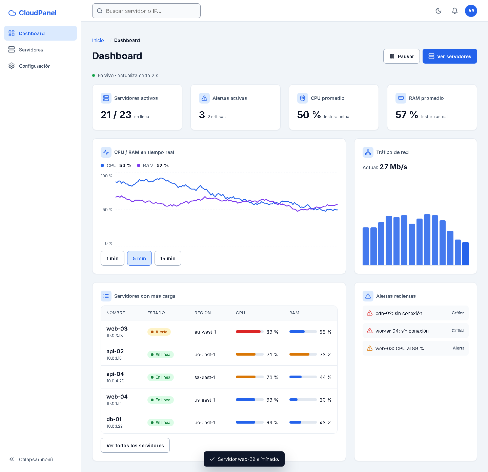

# CloudPanel: Dashboard SPA Responsivo

Panel de control web para **monitorear servidores e instancias cloud**. Muestra métricas en tiempo real, permite configurar servicios desde paneles contextuales y ejecutar acciones administrativas con confirmación segura.

Práctica integral de **Interfaces Web, Unidad 3**. Está hecha con **HTML5 semántico, CSS nativo (sin frameworks) y React**.




## Funcionalidades

- **Monitoreo en tiempo real:** tarjetas de estado, gráfica de CPU/RAM con rangos de 1, 5 y 15 minutos, tráfico de red y alertas. Los datos se actualizan cada 2 s y se pueden pausar.
- **Servidores:** tabla con búsqueda, filtros por estado y región, y paginación. En móvil se convierte en tarjetas.
- **Configuración contextual:** panel deslizante con texto, área de texto, select, calendario, switch y número.
- **Acciones críticas:** para eliminar un servidor hay que escribir su nombre en un modal de confirmación.
- **Modo oscuro:** sigue al sistema operativo (`prefers-color-scheme`) y tiene un toggle manual que se recuerda.

## Instalación y uso

Requiere Node.js 20 o superior.

```bash
npm install
npm run dev       # servidor de desarrollo en http://localhost:5173
npm run build     # compilación de producción en dist/
npm run preview   # sirve la compilación en http://localhost:4173
```

## Arquitectura

### Tres zonas de interfaz

| Zona | Componentes | Responde a |
|---|---|---|
| **1. Navegación** | `Header`, `Sidebar` (persistente y colapsable en escritorio, retráctil en móvil), `Breadcrumbs` | ¿Dónde estoy? (`aria-current`, breadcrumbs) · ¿De dónde vengo? · ¿A dónde puedo ir? |
| **2. Contenido dinámico** | `Dashboard` (bento grid), `Servers` (`ServerTable`, `Pagination`), `Settings`, `Card`, `LineChart`, `BarChart` | El negocio: estado y métricas de los servidores |
| **3. Interacción y acciones críticas** | `ConfigPanel` (panel deslizante), `ConfirmDialog` (modal), `Toast` | Edición de datos y acciones destructivas |

### Estructura del proyecto

```
src/
├── App.jsx                  # Shell: las 3 zonas
├── router.js                # Router por hash (#/dashboard, #/servidores, #/configuracion)
├── context/ServersContext   # Estado global (useReducer) + simulación de métricas en vivo
├── hooks/useTheme.js        # Modo oscuro: sistema + toggle manual + localStorage
├── data/servers.js          # Datos simulados de 24 servidores
├── styles/
│   ├── tokens.css           # Variables :root (colores claro/oscuro, espacios, tiempos)
│   ├── base.css             # Reset, foco visible, spinner, reduced-motion
│   └── layout.css           # CSS Grid del layout general (mobile-first)
├── components/
│   ├── navigation/          # Zona 1
│   ├── content/             # Zona 2
│   ├── interaction/         # Zona 3
│   └── ui/                  # Button, Control, Switch, Icon (5 estados)
└── pages/                   # Dashboard, Servers, Settings
```

### Maquetación

- **Mobile-first:** el CSS base es para celular y se amplía con `@media (min-width: 768px | 1024px | 1280px)`.
- **CSS Grid (bidimensional):** el layout general usa `grid-template-areas` y la vista de métricas es un **bento grid** de 2 → 4 → 12 columnas.
- **Flexbox (unidimensional):** header, sidebar, grupos de botones, alineación de iconos con texto, tarjetas, filtros y paginación.

## Interacción

- **5 estados** en cada botón y campo: Default, Hover, Focus (contorno de 3 px), Disabled y Loading (spinner + `aria-busy`).
- **Microinteracciones** de 200 a 300 ms: hover de tarjetas, transición de botones, apertura y cierre del modal y del panel, menú móvil. Se respeta `prefers-reduced-motion`.
- **Accesibilidad:**
  - Zonas táctiles de 44×44 px y contraste WCAG en ambos temas.
  - `<dialog>` nativo: Escape para cerrar, foco atrapado y retorno del foco.
  - Enlace "Saltar al contenido" y etiquetas ARIA.

La evidencia con capturas y el checklist de las 5 dimensiones de IxD están en el [reporte de validación](docs/REPORTE-VALIDACION.md).

## Tecnologías

- React 19, con estado mediante `useReducer` + Context y sin librerías de UI.
- Vite 8 como entorno de desarrollo y compilación.
- CSS nativo con custom properties, Grid y Flexbox.
- Figma para la User Persona, los wireframes y el prototipo.
